# SecureMDM

> Hệ thống **Mobile Device Management đa tenant** có trọng tâm bảo mật. Gồm backend reactive Java, admin console React và một device agent mô phỏng viết bằng TypeScript.
> Thiết bị có danh tính bằng **X.509 cấp từ CSR**, chứng minh giữ khóa ở **từng request**, và chỉ thực thi **lệnh có chữ ký số**.

**Mọi tác động lên thiết bị đều là mô phỏng.** Simulator đóng vai agent Android; dự án không điều khiển thiết bị thật.

[Hướng dẫn cài đặt và chạy dự án](docs/SETUP.md)

---

## Mục lục

1. [Tổng quan dự án](#1-tổng-quan-dự-án)
2. [Công nghệ sử dụng](#2-công-nghệ-sử-dụng)
3. [Kiến trúc hệ thống](#3-kiến-trúc-hệ-thống)
4. [Luồng hoạt động tổng quát](#4-luồng-hoạt-động-tổng-quát)
5. [Các module](#5-các-module)
6. [Use case chi tiết](#6-use-case-chi-tiết)
   - [6.1 Đăng nhập admin và xoay vòng refresh token](#61-đăng-nhập-admin-và-xoay-vòng-refresh-token)
   - [6.2 Enrollment thiết bị: CSR → chứng chỉ X.509](#62-enrollment-thiết-bị-csr--chứng-chỉ-x509)
   - [6.3 Request của thiết bị với Device Proof](#63-request-của-thiết-bị-với-device-proof)
   - [6.4 Gửi lệnh có chữ ký: tạo → claim → kết quả](#64-gửi-lệnh-có-chữ-ký-tạo--claim--kết-quả)
   - [6.5 Policy và đánh giá compliance](#65-policy-và-đánh-giá-compliance)
   - [6.6 Xoay command signing key bằng signed trust bundle](#66-xoay-command-signing-key-bằng-signed-trust-bundle)
   - [6.7 Thu hồi thiết bị](#67-thu-hồi-thiết-bị)
7. [Tổng quan dữ liệu](#7-tổng-quan-dữ-liệu)
8. [Điểm nổi bật về kỹ thuật](#8-điểm-nổi-bật-về-kỹ-thuật)
9. [Kiểm thử và chất lượng](#9-kiểm-thử-và-chất-lượng)
10. [Quyết định kiến trúc](#10-quyết-định-kiến-trúc)
11. [Trạng thái dự án và hướng phát triển](#11-trạng-thái-dự-án-và-hướng-phát-triển)

---

## 1. Tổng quan dự án

**Vấn đề.** Doanh nghiệp cần quản lý điện thoại của nhân viên từ xa: biết thiết bị nào đang hoạt động, áp chính sách bảo mật (khóa màn hình, mã hóa ổ đĩa, phiên bản OS tối thiểu, ứng dụng bị cấm) và gửi lệnh tới thiết bị. Một hệ thống như vậy phải trả lời được vài câu hỏi khó:

- Làm sao chắc request đến từ **đúng thiết bị đã đăng ký**, kể cả khi token bị lộ?
- Làm sao chắc **lệnh thiết bị nhận được là do server phát hành**, không bị sửa hay chèn trên đường đi?
- Mạng chập chờn, agent crash giữa chừng: lệnh có bị **mất hoặc thực thi hai lần** không?
- Nhiều tổ chức dùng chung một hệ thống: dữ liệu của tổ chức A có **lọt sang tổ chức B** không?

**Mục tiêu.** Xây một MDM thu nhỏ nhưng làm thật phần lõi bảo mật và độ tin cậy. Phần tác động lên phần cứng thì mô phỏng. Dự án là portfolio cho vị trí kỹ sư backend và bảo mật.

**Người dùng.**

| Actor                    | Vai trò                                                           |
| ------------------------ | ----------------------------------------------------------------- |
| `ORG_ADMIN`              | Cấp enrollment token, thu hồi thiết bị, và mọi quyền của OPERATOR |
| `OPERATOR`               | Tạo policy, gán policy, gửi lệnh                                  |
| `VIEWER`                 | Chỉ đọc                                                           |
| Device agent (simulator) | Enroll, heartbeat, nhận lệnh, báo kết quả và compliance           |

**Tính năng chính (đã triển khai).**

- Multi-tenant: mọi truy vấn được scope theo tổ chức; truy cập tài nguyên của tenant khác trả `404`.
- Đăng nhập admin bằng access token ES256 (10 phút) và refresh token xoay vòng, phát hiện dùng lại.
- **Device PKI**: thiết bị tự sinh khóa EC P-256, gửi CSR; Device CA nội bộ cấp chứng chỉ X.509 30 ngày.
- **Device Proof**: mỗi request của agent ký bằng khóa thiết bị, chống replay. Không có bearer token cho thiết bị.
- **Hàng đợi lệnh có chữ ký JWS**: FIFO, lease, retry giới hạn, idempotency key, máy trạng thái rõ ràng.
- **Xoay command signing key** qua trust bundle có chữ ký, không cần cấp lại trust cho thiết bị.
- Policy có version bất biến; server tự đánh giá compliance từ inventory thiết bị báo lên.
- Audit log ghi trong cùng transaction với thay đổi nghiệp vụ.
- Admin console: dashboard, thiết bị (kèm thông tin chứng chỉ), enrollment, policy, lệnh, audit.

---

## 2. Công nghệ sử dụng

| Công nghệ                                             | Vai trò              | Ứng dụng trong dự án                                                                                                                        |
| ----------------------------------------------------- | -------------------- | ------------------------------------------------------------------------------------------------------------------------------------------- |
| Java 21, Spring Boot 4.1, **Spring WebFlux**          | Backend              | REST API `/api/v1` non-blocking. Agent poll và heartbeat liên tục, nên mô hình reactive giữ được nhiều kết nối với ít thread                |
| **Spring Security** (WebFlux)                         | Xác thực, phân quyền | Một filter chung nhận `Bearer` (admin) hoặc `DeviceProof` (thiết bị); CSRF cho các endpoint dùng cookie; RBAC theo route và trong service   |
| **Spring Data R2DBC** + MySQL 8.4                     | Truy cập dữ liệu     | CRUD qua repository; SQL viết tay cho `SELECT ... FOR UPDATE`, upsert, join và phân trang. Transaction reactive qua `TransactionalOperator` |
| **Liquibase** (JDBC, chạy lúc khởi động)              | Migration            | 4 changeset SQL; changeset đã áp dụng không bao giờ sửa                                                                                     |
| **Nimbus JOSE + JWT**                                 | JWS/JWT              | Ký và kiểm tra access token, lệnh, trust bundle, Device Proof (ES256)                                                                       |
| **BouncyCastle** (`bcpkix`)                           | PKI                  | Parse và kiểm tra chữ ký CSR (PKCS#10), dựng và ký chứng chỉ X.509 của Device CA                                                            |
| JCA (Java built-in)                                   | Primitive mật mã     | `SecureRandom` (token, serial), `MessageDigest` SHA-256 (hash token, fingerprint), `BCryptPasswordEncoder` (mật khẩu, cost 12)              |
| React 19, MUI 7, Vite                                 | Frontend             | Admin console, route lazy-load                                                                                                              |
| TanStack Query 5, axios, Zustand                      | Data và state        | Cache theo query key, poll 5 s cho device/command/dashboard; một lượt refresh chung khi gặp 401                                             |
| React Hook Form + Zod 4                               | Form                 | Validate form policy, lệnh, login                                                                                                           |
| Node 24, `jose`, `@peculiar/x509`, WebCrypto          | Device simulator     | Sinh khóa P-256, tạo CSR, ký Device Proof, kiểm tra lệnh và trust bundle                                                                    |
| Docker Compose                                        | Môi trường demo      | MySQL, backend, nginx phục vụ console, simulator; bind loopback                                                                             |
| JUnit 5, Testcontainers, ArchUnit, Vitest, Playwright | Kiểm thử             | Xem [mục 9](#9-kiểm-thử-và-chất-lượng)                                                                                                      |

Vì sao những lựa chọn chính hợp với bài toán:

- **ES256 (ECDSA P-256)** cho mọi chữ ký: khóa và chữ ký nhỏ, hợp với thiết bị di động. P-256 cũng là đường cong mà Android Keystore và Apple Secure Enclave hỗ trợ, nên agent thật có thể giữ khóa trong phần cứng mà không phải đổi giao thức.
- **Nimbus và BouncyCastle** là thư viện đã được kiểm chứng. Dự án không tự cài đặt thuật toán; code chỉ ghép các primitive và **kiểm tra chặt** header, claims.

---

## 3. Kiến trúc hệ thống

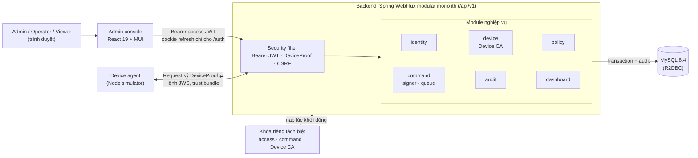

**Kiến trúc: modular monolith.** Có một deployable backend, chia thành 6 module nghiệp vụ: `identity`, `device`, `policy`, `command`, `audit` và `dashboard`. Mỗi module có các tầng controller → service → repository. Phần dùng chung (`security`, `config`, `exception`, `utils`) không được import ngược vào module. ArchUnit kiểm tra quy tắc này trong build.

| Thành phần       | Vai trò                                                                                                                                                      |
| ---------------- | ------------------------------------------------------------------------------------------------------------------------------------------------------------ |
| Admin console    | Giao diện quản trị. Access token chỉ giữ trong bộ nhớ; refresh token nằm trong cookie HttpOnly mà JavaScript không đọc được                                  |
| Security filter  | Chuyển credential thành `Actor` (tenant, id, role). Admin dùng JWT và kiểm tra session còn sống trong DB; thiết bị dùng Device Proof đối chiếu với chứng chỉ |
| Module nghiệp vụ | Nhận `Actor` đã xác thực; mọi SQL có điều kiện `organization_id` lấy từ `Actor`, không bao giờ từ request body                                               |
| MySQL            | Nguồn sự thật duy nhất, gồm cả hàng đợi lệnh. Row lock và transaction bảo đảm tính đúng khi có request đồng thời                                             |
| Khóa riêng       | Ba nhóm khóa P-256 với mục đích khác nhau; backend từ chối khởi động nếu hai nhóm trùng khóa                                                                 |
| Simulator        | Agent mô phỏng: giữ khóa thiết bị, poll lệnh, áp policy, lưu state bền vững và chống thực thi trùng                                                          |

**Vì sao chọn modular monolith:** quy mô demo không cần chi phí vận hành microservice, nhưng ranh giới module vẫn rõ để tách ra sau này. Các thao tác cần tính nhất quán cao vẫn nằm trong một transaction MySQL, ví dụ thu hồi thiết bị kèm hủy lệnh của nó, hoặc nghiệp vụ kèm audit. Xem [ADR 0001](docs/adr/0001-layered-backend.md) và [ADR 0004](docs/adr/0004-modular-backend.md).

---

## 4. Luồng hoạt động tổng quát

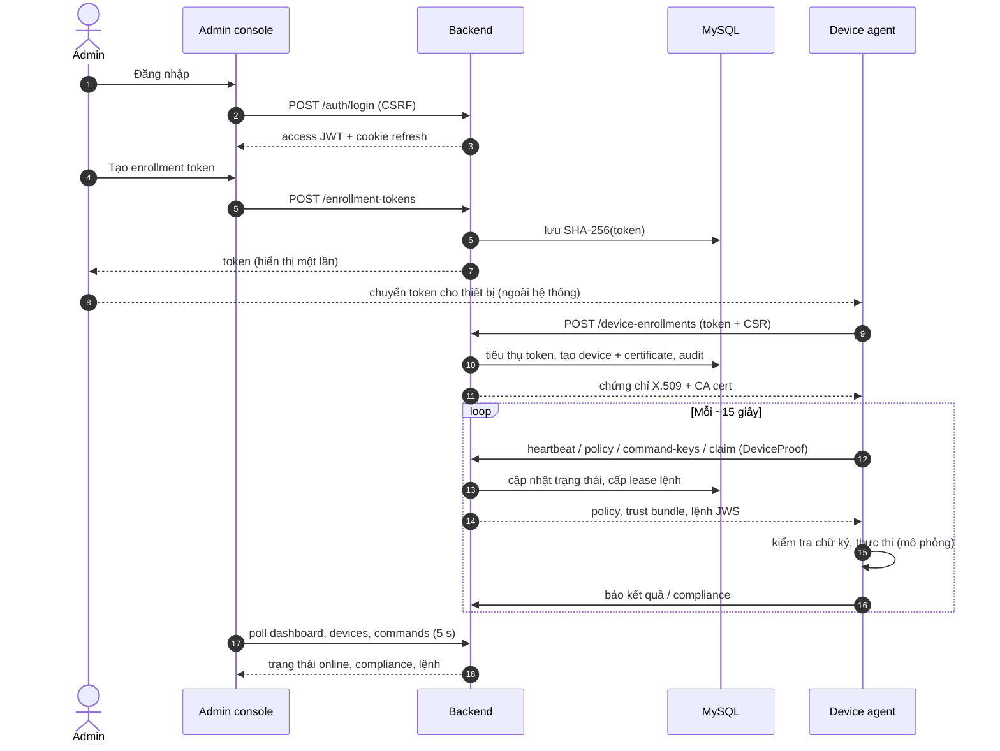

Có hai kênh tách biệt:

- **Kênh admin:** người dùng thao tác trên console. Backend kiểm tra JWT, kiểm tra session trong DB, kiểm tra quyền, rồi ghi thay đổi cùng audit trong một transaction.
- **Kênh thiết bị:** agent **chủ động gọi lên** server (pull), không có push từ server xuống. Mỗi request được ký bằng khóa thiết bị. Server không gửi lệnh trực tiếp; lệnh nằm trong hàng đợi và được giao khi agent claim.

Admin không bao giờ nói chuyện trực tiếp với thiết bị. Mọi trạng thái đi qua database.

---

## 5. Các module

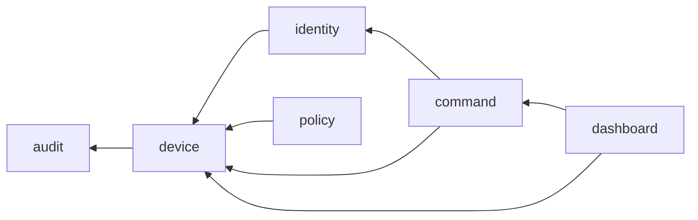

Mũi tên là "phụ thuộc vào". `device` không phụ thuộc `command`. Khi thu hồi thiết bị, `device` gọi interface `DeviceRevocationListener` do chính nó định nghĩa; `command` cài đặt interface đó. Nhờ vậy, việc hủy lệnh nằm trong cùng transaction mà không tạo vòng phụ thuộc.

| Module      | Vai trò                                                     | API chính                                                                                                                                                                  | Cơ chế đặc biệt                                                                                                        |
| ----------- | ----------------------------------------------------------- | -------------------------------------------------------------------------------------------------------------------------------------------------------------------------- | ---------------------------------------------------------------------------------------------------------------------- |
| `identity`  | Tổ chức, user, session, refresh token; xác thực mọi request | `GET /auth/csrf`, `POST /auth/login`, `/auth/refresh`, `/auth/logout`, `GET /auth/me`                                                                                      | BCrypt, JWT ES256, refresh rotation + reuse revocation, CSRF; cài đặt `ActorAuthenticator` (gồm kiểm tra Device Proof) |
| `device`    | Enrollment token, thiết bị, chứng chỉ, heartbeat, thu hồi   | `POST /enrollment-tokens`, `POST /device-enrollments`, `GET /devices`, `GET /devices/{id}`, `POST /devices/{id}/revoke`, `POST /device-agent/heartbeat`                    | Device CA (BouncyCastle), row lock khi tiêu thụ token, bảng replay của Device Proof                                    |
| `policy`    | Policy, version bất biến, gán cho thiết bị, nhận report     | `GET/POST /policies`, `GET/POST /policies/{id}/versions`, `GET/PUT/DELETE /devices/{id}/policy-assignment`, `GET /device-agent/policy`, `POST /device-agent/policy-report` | Assignment revision tăng đơn điệu, từ chối report cũ, rule thuần `ComplianceEvaluator`                                 |
| `command`   | Hàng đợi lệnh có chữ ký                                     | `GET/POST /devices/{id}/commands`, `POST /device-agent/commands/claim`, `POST /device-agent/commands/{id}/result`, `GET /device-agent/command-keys`                        | JWS `mdm-command+jwt`, Idempotency-Key, FIFO `queue_order`, lease, sweeper 5 s, `CommandStateMachine`                  |
| `audit`     | Nhật ký thao tác, chỉ thêm                                  | `GET /audit-logs`                                                                                                                                                          | Ghi trong cùng transaction với thay đổi; không có API sửa hay xóa                                                      |
| `dashboard` | Số liệu tổng quan chỉ đọc                                   | `GET /dashboard/overview`                                                                                                                                                  | Đếm thiết bị online/revoked, lệnh theo trạng thái                                                                      |

Hợp đồng chung: danh sách trả `{items,total,page,size}` (trang bắt đầu từ 0, tối đa 100 phần tử). Lỗi trả `{code,message,status}`, ví dụ `{"code":"MDM404","message":"Resource not found","status":"NOT_FOUND"}`.

---

## 6. Use case chi tiết

Các ví dụ JSON dưới đây dùng giá trị minh họa; token và chữ ký đã được rút gọn bằng `…`. Mọi endpoint có tiền tố `/api/v1`.

### 6.1 Đăng nhập admin và xoay vòng refresh token

#### 6.1.1 Tổng quan

|                  |                                                                                                                                         |
| ---------------- | --------------------------------------------------------------------------------------------------------------------------------------- |
| Mục đích         | Admin đăng nhập và giữ phiên làm việc an toàn; refresh token bị đánh cắp và dùng lại sẽ bị phát hiện                                    |
| Actor            | Admin, Operator, Viewer                                                                                                                 |
| Kết quả          | Access JWT 10 phút (chỉ trong bộ nhớ trình duyệt) và refresh token trong cookie HttpOnly; phiên tuyệt đối 7 ngày                        |
| Kỹ thuật nổi bật | BCrypt, JWT ES256 `typ=at+jwt`, opaque refresh token lưu dạng SHA-256, CSRF double-submit, refresh rotation + reuse detection, row lock |

#### 6.1.2 Sequence diagram

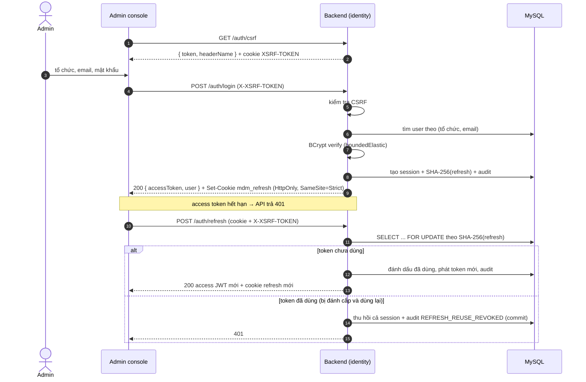

#### 6.1.3 API

**`POST /api/v1/auth/login`**. Header: `Content-Type: application/json`, `X-XSRF-TOKEN: <giá trị từ /auth/csrf>`.

```json
{ "organizationSlug": "alpha", "email": "operator@demo.local", "password": "…" }
```

| Field              | Type   | Ý nghĩa                                                                             |
| ------------------ | ------ | ----------------------------------------------------------------------------------- |
| `organizationSlug` | string | Tổ chức (tenant) người dùng thuộc về; cùng một email có thể tồn tại ở nhiều tổ chức |
| `email`            | string | Định danh người dùng trong tổ chức                                                  |
| `password`         | string | Mật khẩu, tối đa 72 ký tự (giới hạn của BCrypt)                                     |

Response `200 OK`, kèm header `Set-Cookie: mdm_refresh=r_…; HttpOnly; SameSite=Strict; Path=/api/v1/auth`.

```json
{
  "accessToken": "eyJhbGciOiJFUzI1NiIsInR5cCI6ImF0K2p3dCIs…",
  "user": {
    "id": "0b5c…",
    "organizationId": "7f1a…",
    "organizationSlug": "alpha",
    "role": "OPERATOR"
  }
}
```

| Field         | Type         | Ý nghĩa                                                                                                 |
| ------------- | ------------ | ------------------------------------------------------------------------------------------------------- |
| `accessToken` | string (JWS) | Gửi trong `Authorization: Bearer` cho mọi API admin; claims gồm `sub`, `sid` (session), `tenant`, `exp` |
| `user.role`   | string       | `ORG_ADMIN`, `OPERATOR` hoặc `VIEWER`; frontend dùng để ẩn hiện UI, còn backend tự kiểm tra lại quyền   |

`POST /auth/refresh` không có body và trả cùng dạng response. Lỗi đáng chú ý: thiếu CSRF → `403`; refresh token không hợp lệ hoặc bị dùng lại → `401`.

#### 6.1.4 Diễn giải

1. Frontend lấy CSRF token. Endpoint dùng cookie (login, refresh, logout) đòi header CSRF khớp với cookie, nên trang web khác không thể giả mạo request.
2. Backend kiểm tra mật khẩu bằng BCrypt trên thread pool riêng, tránh chặn event loop của WebFlux.
3. Backend tạo session, sinh refresh token ngẫu nhiên 256 bit (`r_…`), chỉ lưu **SHA-256** của nó và phát access JWT ký ES256.
4. Mỗi request API admin, ngoài việc kiểm tra chữ ký JWT, backend còn kiểm tra **session còn hiệu lực trong DB**. Nhờ vậy logout hoặc thu hồi có hiệu lực ngay, không phải chờ JWT hết hạn.
5. Khi refresh, backend khóa dòng token (`FOR UPDATE`): token cũ bị tiêu thụ và token mới được phát hành trong cùng transaction.
6. Nếu một token đã dùng được gửi lại, nghĩa là có hai bên đang giữ cùng token, backend thu hồi **cả session**. Việc thu hồi được commit **trước** khi trả 401, để lỗi không làm rollback việc thu hồi.
7. Trên frontend, Web Locks và BroadcastChannel bảo đảm nhiều tab chỉ refresh tuần tự và đồng bộ logout với nhau.

#### 6.1.5 Kỹ thuật bảo mật

| Kỹ thuật                                               | Mục đích                                                                        | Ứng dụng                        | Implementation                                                                                                                                         |
| ------------------------------------------------------ | ------------------------------------------------------------------------------- | ------------------------------- | ------------------------------------------------------------------------------------------------------------------------------------------------------ |
| BCrypt (cost 12)                                       | Lưu mật khẩu chống brute-force offline                                          | Kiểm tra login                  | `BCryptPasswordEncoder` (Spring Security)                                                                                                              |
| ES256 JWT, `typ=at+jwt`                                | Access token ngắn hạn, không giả mạo được                                       | Mọi API admin                   | Nimbus `ECDSASigner` / `ECDSAVerifier`; kiểm tra chặt `alg`, `typ`, `kid`, `iss=secure-mdm`, `aud=secure-mdm-admin`, `exp`, `iat` (`JwtTokenProvider`) |
| CSPRNG + SHA-256                                       | Token opaque; DB bị lộ cũng không dùng được token                               | Refresh token, enrollment token | `SecureRandom` 32 byte + Base64url; `MessageDigest.getInstance("SHA-256")` (JCA, `SecureTokens`)                                                       |
| Cookie HttpOnly + SameSite=Strict, path `/api/v1/auth` | JavaScript không đọc được refresh token; cookie không gửi kèm request chéo site | Refresh, logout                 | `ResponseCookie` (Spring)                                                                                                                              |
| CSRF double-submit                                     | Chống CSRF trên endpoint dùng cookie                                            | login, refresh, logout          | `CookieServerCsrfTokenRepository` (Spring Security)                                                                                                    |
| Refresh rotation + reuse revocation                    | Phát hiện token bị đánh cắp                                                     | `/auth/refresh`                 | Row lock + transaction, custom (`AuthServiceImpl.refresh`)                                                                                             |

---

### 6.2 Enrollment thiết bị: CSR → chứng chỉ X.509

#### 6.2.1 Tổng quan

|                  |                                                                                                                                     |
| ---------------- | ----------------------------------------------------------------------------------------------------------------------------------- |
| Mục đích         | Đưa một thiết bị mới vào tổ chức và cấp cho nó danh tính mật mã                                                                     |
| Actor            | `ORG_ADMIN` (cấp token), device agent (enroll)                                                                                      |
| Kết quả          | Thiết bị `ACTIVE`, có chứng chỉ X.509 30 ngày gắn với public key do chính thiết bị sinh; **private key không bao giờ rời thiết bị** |
| Kỹ thuật nổi bật | Enrollment token dùng một lần, CSR PKCS#10, Device CA nội bộ, row lock, transaction nguyên tử                                       |

#### 6.2.2 Sequence diagram

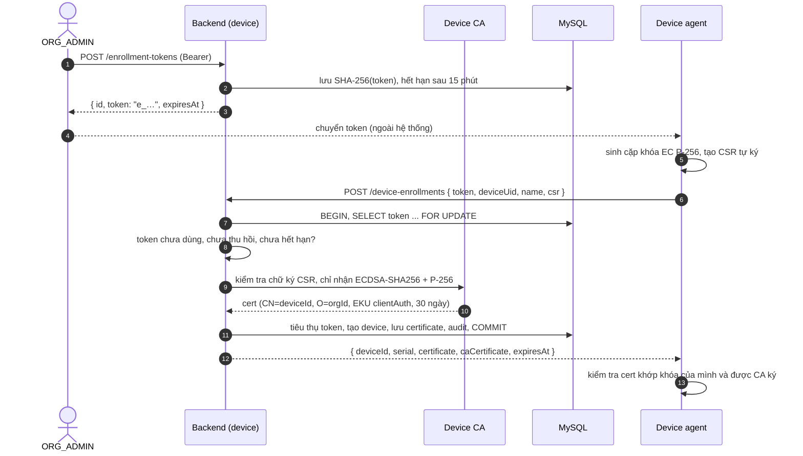

#### 6.2.3 API

**`POST /api/v1/enrollment-tokens`**: header `Authorization: Bearer <access JWT>`, không có body. Response `200`:

```json
{ "id": "3c9e…", "token": "e_Qm9…", "expiresAt": 1793700000000 }
```

**`POST /api/v1/device-enrollments`**: không cần đăng nhập; token chính là credential.

```json
{
  "token": "e_Qm9…",
  "deviceUid": "interview-android",
  "name": "Interview Android",
  "csr": "-----BEGIN CERTIFICATE REQUEST-----\nMIIB…\n-----END CERTIFICATE REQUEST-----\n"
}
```

| Field       | Type         | Ý nghĩa                                                                      |
| ----------- | ------------ | ---------------------------------------------------------------------------- |
| `token`     | string       | Enrollment token một lần, xác định tổ chức mà thiết bị sẽ thuộc về           |
| `deviceUid` | string       | Định danh phần cứng do agent tự khai báo; duy nhất trong tổ chức             |
| `name`      | string       | Tên hiển thị trên console                                                    |
| `csr`       | string (PEM) | PKCS#10 chứa public key P-256 của thiết bị, tự ký bằng private key tương ứng |

Response `200`:

```json
{
  "deviceId": "9d2f…",
  "organizationId": "7f1a…",
  "serial": "a3f1c0…",
  "certificate": "-----BEGIN CERTIFICATE-----\n…",
  "caCertificate": "-----BEGIN CERTIFICATE-----\n…",
  "expiresAt": 1796292000000
}
```

| Field           | Type         | Ý nghĩa                                                             |
| --------------- | ------------ | ------------------------------------------------------------------- |
| `serial`        | string (hex) | Serial ngẫu nhiên 128 bit; thiết bị dùng làm `kid` cho Device Proof |
| `certificate`   | string (PEM) | Chứng chỉ của thiết bị do Device CA ký                              |
| `caCertificate` | string (PEM) | Chứng chỉ Device CA, để thiết bị tự kiểm tra cert vừa nhận          |
| `expiresAt`     | epoch ms     | Hết hạn sau 30 ngày; khi đó thiết bị phải enroll lại                |

Lỗi đáng chú ý: token sai, hết hạn, đã dùng hoặc đã thu hồi → `401`; CSR không hợp lệ → `400` (token **vẫn dùng được**); `deviceUid` đã tồn tại → `409`.

#### 6.2.4 Diễn giải

1. Admin cấp token. Plaintext chỉ hiển thị một lần; DB chỉ giữ hash.
2. Agent tự sinh khóa và CSR. CSR tự ký là bằng chứng agent **đang giữ private key** của public key nó gửi lên.
3. Backend khóa dòng token. Hai request enroll đồng thời với cùng token thì chỉ một request thành công.
4. Chứng chỉ được cấp **trước** khi ghi bất cứ gì. CSR lỗi thì dừng ngay và token còn nguyên.
5. Device CA **bỏ qua subject trong CSR** và tự đặt `CN=deviceId, O=organizationId`. Thiết bị không thể tự nhận mình thuộc tenant khác.
6. Tiêu thụ token, tạo device, lưu certificate (kèm public key JWK, fingerprint SHA-256) và hai bản ghi audit nằm trong **một transaction**. Bất kỳ bước nào lỗi thì rollback toàn bộ.

#### 6.2.5 Kỹ thuật bảo mật và mật mã

| Kỹ thuật                    | Mục đích                                     | Ứng dụng             | Implementation                                                                                                                                                                            |
| --------------------------- | -------------------------------------------- | -------------------- | ----------------------------------------------------------------------------------------------------------------------------------------------------------------------------------------- |
| Sinh khóa EC P-256          | Khóa danh tính của thiết bị, sinh tại chỗ    | Simulator khi enroll | `crypto.subtle.generateKey({name:'ECDSA', namedCurve:'P-256'})`: WebCrypto, built-in của Node 24                                                                                          |
| CSR PKCS#10                 | Gửi public key và chứng minh giữ private key | Simulator → backend  | `Pkcs10CertificateRequestGenerator.create` (`@peculiar/x509`, third-party)                                                                                                                |
| Kiểm tra CSR                | Chặn CSR giả hoặc sai loại khóa              | Backend              | `PKCS10CertificationRequest.isSignatureValid` (BouncyCastle `bcpkix`); chỉ nhận OID `ecdsa-with-SHA256` và đường cong P-256 (`DeviceCertificateAuthority.verifiedKey`)                    |
| Ký chứng chỉ X.509 v3       | Cấp danh tính có hạn cho thiết bị            | Backend              | `JcaX509v3CertificateBuilder` + `JcaContentSignerBuilder("SHA256withECDSA")` (BouncyCastle). Extension: `BasicConstraints(false)`, `KeyUsage.digitalSignature`, `EKU clientAuth`, AKI/SKI |
| Serial ngẫu nhiên 128 bit   | Serial không đoán được, dùng làm `kid`       | Backend              | `new BigInteger(128, SecureRandom)` (JCA)                                                                                                                                                 |
| Fingerprint SHA-256         | Nhận diện chứng chỉ trên UI                  | Backend              | `MessageDigest.getInstance("SHA-256")` trên DER (JCA)                                                                                                                                     |
| Kiểm tra cert phía thiết bị | Phát hiện server trả cert không khớp khóa    | Simulator            | So JWK thumbprint (`jose.calculateJwkThumbprint`) + `X509Certificate.verify` với CA (`@peculiar/x509`)                                                                                    |
| Row lock + transaction      | Token dùng một lần, ghi nguyên tử            | Backend              | `SELECT … FOR UPDATE` + `TransactionalOperator` (custom SQL, Spring R2DBC)                                                                                                                |

Device CA dùng khóa riêng (`device-ca.json`); chứng chỉ CA được dựng lại từ khóa này mỗi lần khởi động. Quyết định chi tiết: [ADR 0005](docs/adr/0005-device-identity-x509-proof-of-possession.md), [spec Device PKI](docs/specs/device-pki.md).

---

### 6.3 Request của thiết bị với Device Proof

#### 6.3.1 Tổng quan

|                  |                                                                                                                                            |
| ---------------- | ------------------------------------------------------------------------------------------------------------------------------------------ |
| Mục đích         | Xác thực **mọi** request của agent bằng private key của thiết bị, không dùng bearer token có thể bị đánh cắp                               |
| Actor            | Device agent                                                                                                                               |
| Kết quả          | Request được gắn với `Actor` thiết bị (tenant và deviceId suy ra từ chứng chỉ). Proof bị bắt được trên đường không dùng lại được           |
| Kỹ thuật nổi bật | Proof-of-possession theo ý tưởng của DPoP (nhưng không theo đúng RFC 9449), ràng buộc method + path, cửa sổ ±60 s, chống replay bằng `jti` |

#### 6.3.2 Sequence diagram (ví dụ heartbeat)

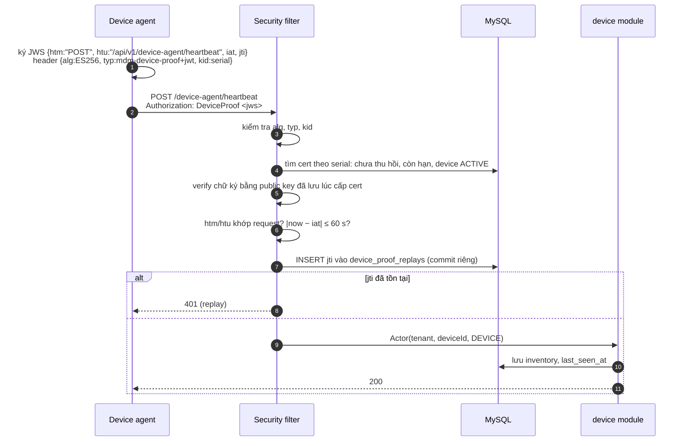

#### 6.3.3 API

**`POST /api/v1/device-agent/heartbeat`**. Header `Authorization: DeviceProof <jws>`.

```json
{
  "screenLockEnabled": true,
  "diskEncrypted": true,
  "androidApiLevel": 35,
  "installedPackages": ["com.android.chrome", "com.example.mail"]
}
```

| Field               | Type     | Ý nghĩa                                         |
| ------------------- | -------- | ----------------------------------------------- |
| `screenLockEnabled` | boolean  | Thiết bị đã bật khóa màn hình hay chưa          |
| `diskEncrypted`     | boolean  | Ổ đĩa đã mã hóa hay chưa                        |
| `androidApiLevel`   | int      | Phiên bản OS, dùng cho rule phiên bản tối thiểu |
| `installedPackages` | string[] | Ứng dụng đã cài, dùng cho rule ứng dụng bị cấm  |

Response `200`, body rỗng. Thiết bị được coi là `ONLINE` nếu heartbeat cuối cách hiện tại không quá 90 giây (server tính theo giờ của server). Proof sai, cert hết hạn hoặc bị thu hồi, replay → `401`.

Claims của Device Proof:

| Claim          | Ý nghĩa                                                               |
| -------------- | --------------------------------------------------------------------- |
| `kid` (header) | Serial chứng chỉ, dùng để tìm public key                              |
| `htm`          | HTTP method của request này                                           |
| `htu`          | Path + query của request này (ví dụ `/api/v1/device-agent/heartbeat`) |
| `iat`          | Thời điểm ký; lệch quá 60 s so với server thì bị từ chối              |
| `jti`          | ID ngẫu nhiên (UUID), dùng một lần                                    |

#### 6.3.4 Diễn giải

1. Mỗi request, agent ký một JWS mới. Proof chỉ hợp lệ cho đúng method và path đó, trong 60 giây và một lần duy nhất.
2. Server **không tin public key trong request**. Nó dùng public key đã lưu lúc cấp chứng chỉ, tìm qua `kid` = serial.
3. Tenant và deviceId lấy từ bản ghi chứng chỉ, không lấy từ body. Thiết bị không thể giả làm thiết bị khác.
4. `jti` được ghi vào `device_proof_replays` bằng **statement riêng, commit trước nghiệp vụ**. Nếu nghiệp vụ lỗi sau đó, proof vẫn bị coi là đã dùng. Bản ghi được giữ tới `iat + 60 s`, sau đó proof tự hết hạn.

#### 6.3.5 Kỹ thuật bảo mật và mật mã

| Kỹ thuật                        | Mục đích                                                 | Ứng dụng        | Implementation                                                                                              |
| ------------------------------- | -------------------------------------------------------- | --------------- | ----------------------------------------------------------------------------------------------------------- |
| Ký proof ES256                  | Chứng minh giữ private key ở từng request                | Simulator       | `new SignJWT(...).setProtectedHeader({alg:'ES256', typ:'mdm-device-proof+jwt', kid})` (`jose`, third-party) |
| Verify proof                    | Kiểm tra chữ ký bằng khóa đã đăng ký                     | Backend         | Nimbus `SignedJWT.parse` + `ECDSAVerifier` (`DeviceProofs.parse/verify`, custom logic trên thư viện)        |
| Ràng buộc `htm`/`htu`           | Proof của endpoint này không dùng được cho endpoint khác | Backend         | So với method và raw path + query của request (`BearerTokenConverter`)                                      |
| Cửa sổ thời gian + `jti` unique | Chống replay                                             | Backend + MySQL | Bảng `device_proof_replays` có unique key; vi phạm → 401                                                    |
| Kiểm tra trạng thái cert        | Thu hồi có hiệu lực ngay ở request kế tiếp               | Backend         | `findUsable(serial, now)`: `revoked_at IS NULL`, `not_before ≤ now < not_after`, device `ACTIVE`            |

So với mTLS: Device Proof hoạt động ở tầng ứng dụng, đi qua được reverse proxy hay load balancer mà không cần cấu hình TLS client cert. Đổi lại, nó không bảo vệ tính bí mật của kênh truyền; việc đó vẫn cần HTTPS.

---

### 6.4 Gửi lệnh có chữ ký: tạo → claim → kết quả

#### 6.4.1 Tổng quan

|                  |                                                                                                                                  |
| ---------------- | -------------------------------------------------------------------------------------------------------------------------------- |
| Mục đích         | Operator gửi lệnh tới thiết bị và theo dõi kết quả một cách tin cậy                                                              |
| Actor            | `OPERATOR`/`ORG_ADMIN` (tạo), device agent (claim, báo kết quả)                                                                  |
| Kết quả          | Lệnh đi qua `PENDING → IN_PROGRESS → SUCCEEDED/FAILED`; không thực thi trùng khi retry; thiết bị từ chối lệnh không do server ký |
| Kỹ thuật nổi bật | Idempotency-Key, JWS `mdm-command+jwt`, row lock, FIFO, lease có hạn, retry giới hạn, máy trạng thái, dedup phía agent           |

Bốn loại lệnh, có kiểm tra payload và kết quả: `SHOW_MESSAGE`, `REPORT_STATUS`, `SYNC_DEVICE`, `LOCK_DEVICE_SIMULATED`. Hệ thống không nhận shell hay script tùy ý.

#### 6.4.2 Sequence diagram

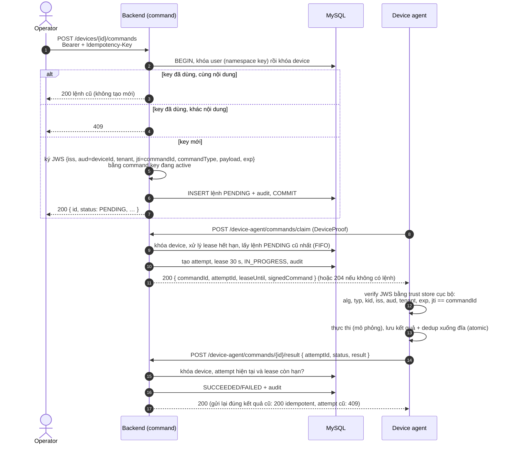

Vòng đời lệnh (sweeper chạy mỗi 5 giây; claim cũng tự xử lý lease hết hạn):

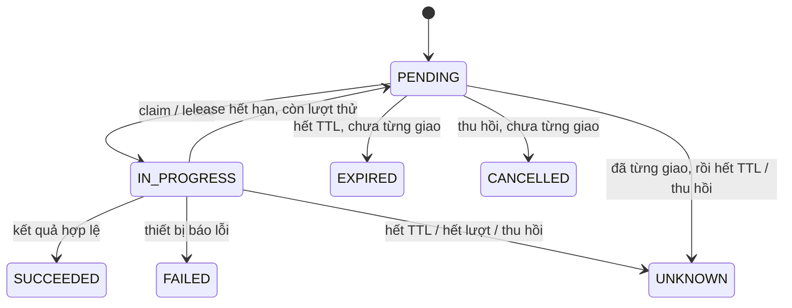

`UNKNOWN` khác `FAILED`: lệnh đã được giao nhưng server không biết thiết bị đã thực thi hay chưa. Hệ thống không đoán kết quả.

#### 6.4.3 API

**`POST /api/v1/devices/{deviceId}/commands`**. Header `Authorization: Bearer …`, `Idempotency-Key: show-msg-20261104-01` (regex `[A-Za-z0-9_-]{1,100}`).

```json
{ "type": "SHOW_MESSAGE", "payload": { "message": "Vui lòng cập nhật hệ điều hành" } }
```

| Field     | Type   | Ý nghĩa                                                                   |
| --------- | ------ | ------------------------------------------------------------------------- |
| `type`    | string | Loại lệnh trong danh sách cho phép                                        |
| `payload` | object | Tham số theo từng loại; `SHOW_MESSAGE` chỉ nhận đúng một trường `message` |

Response `200`:

```json
{
  "id": "c41e…",
  "deviceId": "9d2f…",
  "type": "SHOW_MESSAGE",
  "payload": { "message": "Vui lòng cập nhật hệ điều hành" },
  "status": "PENDING",
  "attempts": 0,
  "createdAt": 1793700000000,
  "expiresAt": 1793700600000
}
```

| Field       | Type     | Ý nghĩa                                        |
| ----------- | -------- | ---------------------------------------------- |
| `status`    | string   | Trạng thái hiện tại theo máy trạng thái ở trên |
| `attempts`  | int      | Số lần đã giao (tối đa 3)                      |
| `expiresAt` | epoch ms | TTL 10 phút; cũng là `exp` trong JWS           |

**`POST /api/v1/device-agent/commands/claim`** (DeviceProof, không có body). Response `200`:

```json
{
  "commandId": "c41e…",
  "attemptId": "a77b…",
  "leaseUntil": 1793700030000,
  "signedCommand": "eyJhbGciOiJFUzI1NiIsInR5cCI6Im1kbS1jb21tYW5kK2p3dCIs…"
}
```

| Field           | Type         | Ý nghĩa                                                          |
| --------------- | ------------ | ---------------------------------------------------------------- |
| `attemptId`     | string       | Định danh lượt giao này; kết quả phải mang đúng attempt hiện tại |
| `leaseUntil`    | epoch ms     | Hạn báo kết quả; quá hạn thì lệnh được giao lại                  |
| `signedCommand` | string (JWS) | Lệnh có chữ ký; agent chỉ thực thi sau khi verify                |

Không có lệnh, hoặc đang có lệnh `IN_PROGRESS`: `204 No Content`. Mỗi thiết bị chỉ có một lease tại một thời điểm.

**`POST /api/v1/device-agent/commands/{id}/result`** (DeviceProof):

```json
{ "attemptId": "a77b…", "status": "SUCCEEDED", "result": { "displayed": true } }
```

| Field       | Type   | Ý nghĩa                                                                                     |
| ----------- | ------ | ------------------------------------------------------------------------------------------- |
| `attemptId` | string | Attempt mà kết quả này thuộc về                                                             |
| `status`    | string | `SUCCEEDED` hoặc `FAILED`                                                                   |
| `result`    | object | Theo loại lệnh, ví dụ `{displayed:true}`, `{inventory:{…}}`, hoặc `{errorCode:"…"}` khi lỗi |

Response `200` là `CommandResponse` đã cập nhật. Attempt không còn hiện hành hoặc lease đã hết → `409`.

#### 6.4.4 Diễn giải

1. **Idempotency:** khóa theo `(tenant, user, Idempotency-Key)`. Hash SHA-256 của `(device, type, payload)` phân biệt "gửi lại cùng request" (trả lệnh cũ) với "dùng lại key cho request khác" (409). Hệ thống khóa user trước, rồi mới khóa device, để cùng một key gửi cho hai thiết bị không tranh nhau unique constraint.
2. **Ký khi tạo:** lệnh được ký một lần lúc tạo và lưu nguyên JWS. Lần giao lại vẫn dùng đúng chữ ký đó.
3. **FIFO:** thứ tự dựa vào cột auto-increment `queue_order`, không dựa vào timestamp, vì hai lệnh có thể trùng mili-giây.
4. **Lease:** claim tạo attempt mới với lease 30 giây. Nếu agent crash, lease hết hạn và lệnh quay lại `PENDING` (tối đa 3 lần). Không transaction nào giữ lock trong lúc chờ mạng.
5. **Phía agent:** agent verify chữ ký bằng trust store **cục bộ**, không bao giờ lấy khóa từ header lệnh. Nó ghi tác động và kết quả xuống đĩa nguyên tử **trước** khi báo server. Nếu crash sau khi ghi, lần claim sau trả lại kết quả đã lưu thay vì thực thi lại.
6. **Kết quả:** chỉ attempt hiện tại, còn lease và còn TTL mới được chấp nhận. Gửi lại đúng kết quả đã nhận là thao tác idempotent: không thay đổi gì và không ghi thêm audit.

Hệ thống bảo đảm **at-least-once delivery** cộng với **dedup phía agent**. Nó không hứa exactly-once qua mạng.

#### 6.4.5 Kỹ thuật bảo mật và mật mã

| Kỹ thuật                             | Mục đích                                                                    | Ứng dụng             | Implementation                                                                                                                                |
| ------------------------------------ | --------------------------------------------------------------------------- | -------------------- | --------------------------------------------------------------------------------------------------------------------------------------------- |
| Ký lệnh ES256, `typ=mdm-command+jwt` | Thiết bị chỉ chạy lệnh do server phát hành, không bị sửa                    | Backend khi tạo lệnh | Nimbus `ECDSASigner` (`CommandSigner.sign`); claims: `iss`, `aud=deviceId`, `jti=commandId`, `tenant`, `commandType`, `payload`, `iat`, `exp` |
| Verify lệnh                          | Từ chối sai thuật toán, loại, khóa, issuer, tenant, thiết bị, thời gian, ID | Simulator            | `jwtVerify(signed, createLocalJWKSet(trust), {algorithms:['ES256'], typ:'mdm-command+jwt'})` (`jose`) + kiểm tra claim tùy biến               |
| Key separation                       | Lộ access key không giả được lệnh, và ngược lại                             | Backend khởi động    | So JWK thumbprint giữa access, command và Device CA key (`SigningKeys`, `DeviceCertificateAuthority`; Nimbus `computeThumbprint`)             |
| SHA-256 request hash                 | So sánh nội dung cho Idempotency-Key                                        | Backend              | `SecureTokens.hash(JSON)` (JCA)                                                                                                               |
| Row lock (`FOR UPDATE`)              | Serialize tạo, claim và báo kết quả trên cùng thiết bị                      | Backend              | Custom SQL trong `*RepositoryCustomImpl` (R2DBC)                                                                                              |
| Dedup + ghi file nguyên tử           | Không lặp tác động khi crash hoặc retry                                     | Simulator            | File mode 0600, fsync, atomic rename, `proper-lockfile`                                                                                       |

Tính tương thích chữ ký Java → TypeScript được kiểm tra bằng fixture: lệnh do Nimbus ký phải được `jose` chấp nhận, và lệnh bị sửa phải bị từ chối.

---

### 6.5 Policy và đánh giá compliance

#### 6.5.1 Tổng quan

|                  |                                                                                               |
| ---------------- | --------------------------------------------------------------------------------------------- |
| Mục đích         | Định nghĩa yêu cầu bảo mật, gán cho thiết bị và biết thiết bị có tuân thủ không               |
| Actor            | `OPERATOR` (tạo và gán), device agent (tải policy và báo cáo)                                 |
| Kết quả          | Mỗi thiết bị có trạng thái `PENDING`, `COMPLIANT`, `NON_COMPLIANT` hoặc `UNKNOWN`, kèm lý do  |
| Kỹ thuật nổi bật | Version bất biến, assignment revision, từ chối report cũ, **server tự đánh giá** từ inventory |

#### 6.5.2 Sequence diagram

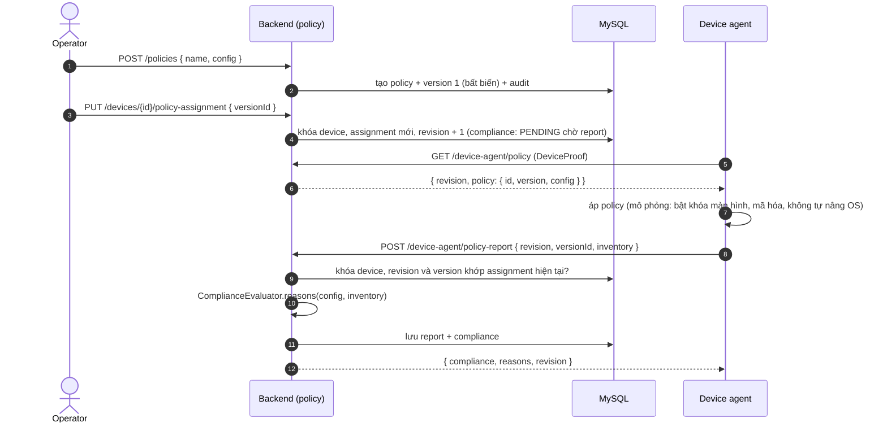

#### 6.5.3 API

**`POST /api/v1/policies`**

```json
{
  "name": "Baseline Android",
  "config": {
    "requireScreenLock": true,
    "requireDiskEncryption": true,
    "minAndroidApiLevel": 34,
    "blockedPackages": ["com.example.torrent"]
  }
}
```

| Field                          | Type     | Ý nghĩa                 |
| ------------------------------ | -------- | ----------------------- |
| `config.requireScreenLock`     | boolean  | Bắt buộc khóa màn hình  |
| `config.requireDiskEncryption` | boolean  | Bắt buộc mã hóa ổ đĩa   |
| `config.minAndroidApiLevel`    | int      | API level tối thiểu     |
| `config.blockedPackages`       | string[] | Ứng dụng không được cài |

Response `200`: `{ id, policyId, version: 1, config, createdAt, … }`. Sửa policy bằng `POST /policies/{id}/versions`; mỗi lần sửa tạo version mới và không ghi đè version cũ.

**`PUT /api/v1/devices/{id}/policy-assignment`**: body `{ "versionId": "…" }`, response `{ "revision": 3, "policy": { … } }`.

**`POST /api/v1/device-agent/policy-report`** (DeviceProof):

```json
{
  "revision": 3,
  "versionId": "5b0d…",
  "inventory": {
    "screenLockEnabled": true,
    "diskEncrypted": true,
    "androidApiLevel": 33,
    "installedPackages": []
  }
}
```

Response `200`:

```json
{ "compliance": "NON_COMPLIANT", "reasons": ["OS_VERSION_TOO_LOW"], "revision": 3 }
```

`reasons` có thể chứa: `SCREEN_LOCK_REQUIRED`, `DISK_ENCRYPTION_REQUIRED`, `OS_VERSION_TOO_LOW`, `BLOCKED_PACKAGE_INSTALLED`. Report có revision hoặc version cũ, hoặc thiết bị không có assignment → `409`.

#### 6.5.4 Diễn giải

1. Version bất biến, nên luôn biết chính xác thiết bị đang được đánh giá theo nội dung nào. Tạo version mới **không** tự đổi assignment hiện có.
2. Mỗi lần gán hoặc bỏ gán, `revision` tăng. Report chỉ được chấp nhận khi đúng revision và version hiện hành, nhờ vậy report đến muộn của policy cũ không ghi đè trạng thái mới.
3. **Server** tính compliance từ inventory, thay vì tin thiết bị tự báo "tôi đạt". Trạng thái là `PENDING` khi đang chờ report đúng revision, và `UNKNOWN` khi thiết bị offline, report quá cũ hoặc chưa được gán policy.
4. Giới hạn: inventory vẫn là dữ liệu thiết bị **tự khai báo**. Không có hardware attestation, nên một agent đã bị chiếm vẫn có thể nói dối.

#### 6.5.5 Kỹ thuật

| Kỹ thuật                  | Mục đích                             | Ứng dụng      | Implementation                                                  |
| ------------------------- | ------------------------------------ | ------------- | --------------------------------------------------------------- |
| Immutable versioning      | Truy vết và đánh giá nhất quán       | Policy        | Bảng `policy_versions` chỉ thêm                                 |
| Optimistic revision check | Chặn report cũ ghi đè trạng thái mới | Policy report | So `revision` + `versionId` dưới row lock của device, sai → 409 |
| Pure rule                 | Dễ test, không phụ thuộc DB          | Đánh giá      | `ComplianceEvaluator` (custom, unit test trong `LogicTests`)    |

---

### 6.6 Xoay command signing key bằng signed trust bundle

#### 6.6.1 Tổng quan

|                  |                                                                                                                                     |
| ---------------- | ----------------------------------------------------------------------------------------------------------------------------------- |
| Mục đích         | Thay khóa ký lệnh định kỳ hoặc khi nghi lộ khóa, mà không phải cấp lại trust cho từng thiết bị                                      |
| Actor            | Người vận hành (đổi cấu hình), device agent                                                                                         |
| Kết quả          | Thiết bị học khóa mới qua bundle được ký bởi khóa nó **đã tin**; lệnh cũ và lệnh mới đều được chấp nhận trong giai đoạn chuyển tiếp |
| Kỹ thuật nổi bật | Trust anchor cấp sẵn, JWS `mdm-trust+jwt`, xoay 3 giai đoạn, chống rollback bằng `iat`                                              |

#### 6.6.2 Sequence diagram

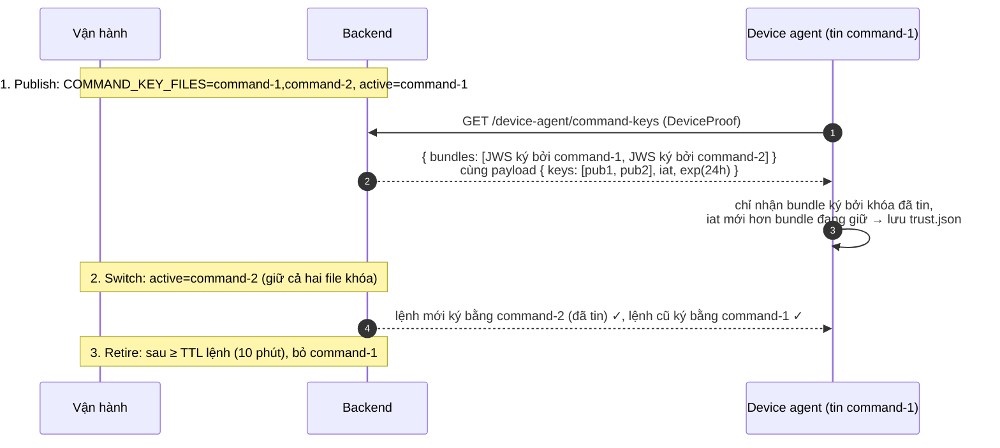

#### 6.6.3 API

**`GET /api/v1/device-agent/command-keys`** (DeviceProof). Response `200`:

```json
{
  "bundles": [
    "eyJhbGciOiJFUzI1NiIsInR5cCI6Im1kbS10cnVzdCtqd3QiLCJraWQiOiJjb21tYW5kLTEifQ.…",
    "eyJ…kid…command-2….…"
  ]
}
```

| Field     | Type     | Ý nghĩa                                                                                                                   |
| --------- | -------- | ------------------------------------------------------------------------------------------------------------------------- |
| `bundles` | string[] | Mỗi phần tử là một JWS `mdm-trust+jwt` có cùng payload (danh sách public key đang publish), ký bởi từng khóa đang publish |

#### 6.6.4 Diễn giải

1. Simulator được cấp sẵn **một** public key (`command-1`) làm trust anchor.
2. Mỗi lần heartbeat, agent tải bundle và chỉ chấp nhận bundle được ký bởi khóa đã có trong trust store. Thiết bị lỡ bước 1 vẫn bắt kịp nhờ bundle ký bằng khóa cũ.
3. Agent từ chối bundle có `iat` cũ hơn bundle đang giữ, nên không ai có thể gửi lại một danh sách khóa cũ (rollback).
4. Giới hạn đã ghi nhận: bên giữ được **private command key** (ví dụ chiếm được backend và các file khóa) vẫn ký được bundle hợp lệ. Muốn chống trường hợp này cần HSM hoặc KMS. Xem [ADR 0006](docs/adr/0006-command-key-rotation-signed-trust-bundle.md).

#### 6.6.5 Kỹ thuật

| Kỹ thuật                              | Mục đích                          | Implementation                                                                                       |
| ------------------------------------- | --------------------------------- | ---------------------------------------------------------------------------------------------------- |
| Ký trust bundle                       | Chuyển giao trust có xác thực     | Nimbus `ECDSASigner`, `JWKSet` public-only (`CommandSigner.trustBundles`)                            |
| Verify bundle                         | Chỉ tin bundle ký bởi khóa đã tin | `jose.jwtVerify` + `createLocalJWKSet` (`simulator/src/trust.ts`); chỉ giữ các trường public của JWK |
| Một khóa active, nhiều khóa published | Tách "khóa ký" và "khóa được tin" | `SigningKeys` (`COMMAND_KEY_FILES`, `COMMAND_ACTIVE_KID`)                                            |

---

### 6.7 Thu hồi thiết bị

#### 6.7.1 Tổng quan

|                  |                                                                                                                                                      |
| ---------------- | ---------------------------------------------------------------------------------------------------------------------------------------------------- |
| Mục đích         | Cắt quyền truy cập của thiết bị bị mất hoặc bị chiếm                                                                                                 |
| Actor            | `ORG_ADMIN`                                                                                                                                          |
| Kết quả          | Thiết bị `REVOKED`, chứng chỉ bị thu hồi, lệnh còn mở bị `CANCELLED` (chưa từng giao) hoặc `UNKNOWN` (đã giao); request kế tiếp của agent nhận `401` |
| Kỹ thuật nổi bật | Row lock, listener giữa các module trong cùng transaction, kiểm tra trạng thái ở mỗi request                                                         |

#### 6.7.2 Sequence diagram

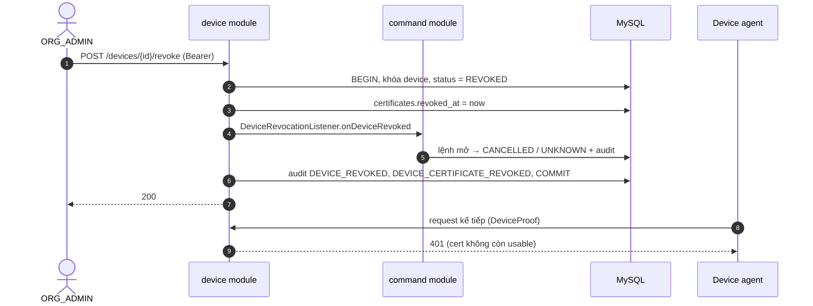

#### 6.7.3 API

`POST /api/v1/devices/{id}/revoke`: header `Authorization: Bearer …`, không body, response `200` rỗng. Thiết bị thuộc tenant khác → `404`; người gọi không phải `ORG_ADMIN` → `403`.

#### 6.7.4 Diễn giải

1. Hệ thống khóa device trước, nên một lệnh đang được tạo hay claim song song không chen vào giữa.
2. Thu hồi thiết bị, chứng chỉ và lệnh trong **một transaction**, kèm audit.
3. Device Proof kiểm tra trạng thái chứng chỉ ở **mỗi request**, nên thu hồi có hiệu lực ngay mà không cần CRL hay OCSP. Đây là lợi thế khi CA và relying party là cùng một hệ thống.
4. Thu hồi không đảo ngược được tác động đã xảy ra trên thiết bị. Vì vậy lệnh đã giao mà chưa có kết quả được đánh dấu `UNKNOWN`, không phải `FAILED`.

---

## 7. Tổng quan dữ liệu

MySQL 8.4 là nguồn sự thật duy nhất, kể cả cho hàng đợi lệnh. Hệ thống không dùng message broker. Schema do Liquibase quản lý qua 4 changeset SQL.

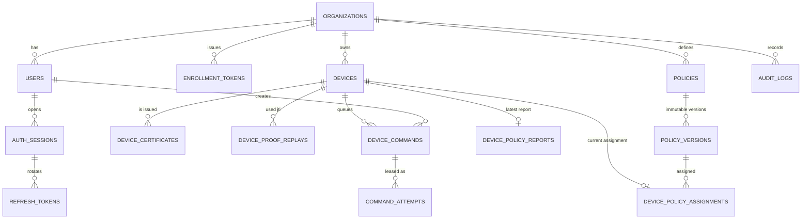

| Nhóm dữ liệu    | Bảng                                                                                | Vai trò trong use case                                                                     |
| --------------- | ----------------------------------------------------------------------------------- | ------------------------------------------------------------------------------------------ |
| Identity        | `organizations`, `users`, `auth_sessions`, `refresh_tokens`                         | Đăng nhập; refresh token chỉ lưu hash, có cờ đã dùng để phát hiện reuse                    |
| Thiết bị và PKI | `enrollment_tokens`, `devices`, `device_certificates`, `device_proof_replays`       | Enrollment; chứng chỉ lưu PEM, public key JWK, serial, fingerprint, thời hạn, `revoked_at` |
| Policy          | `policies`, `policy_versions`, `device_policy_assignments`, `device_policy_reports` | Version bất biến (config lưu JSON), assignment có `revision`                               |
| Command         | `device_commands`, `command_attempts`                                               | Hàng đợi: JWS đã ký, `queue_order`, idempotency key + request hash, lease của từng attempt |
| Audit           | `audit_logs`                                                                        | Actor, tenant, action, resource, correlation ID; không lưu secret                          |

Những điểm thiết kế dữ liệu ảnh hưởng tới nghiệp vụ:

- **Tenant isolation ở tầng schema:** các bảng nghiệp vụ dùng **foreign key ghép `(organization_id, id)`**. Database không cho phép, chẳng hạn, gán policy version của tenant A cho thiết bị của tenant B, kể cả khi code có lỗi.
- **Không lưu secret dạng gốc:** token chỉ có hash SHA-256, mật khẩu là BCrypt. Private key không nằm trong DB; khóa thiết bị chỉ ở phía thiết bị.
- Timestamp là epoch milliseconds UTC; ID là UUID dạng chuỗi.
- `device_credentials` (cơ chế bearer cũ) đã được xóa bằng changeset mới, không sửa changeset cũ.

---

## 8. Điểm nổi bật về kỹ thuật

| Kỹ thuật                                     | Ở đâu                                        | Giải quyết vấn đề gì                                               | Áp dụng như thế nào                                                                                                       |
| -------------------------------------------- | -------------------------------------------- | ------------------------------------------------------------------ | ------------------------------------------------------------------------------------------------------------------------- |
| **Device PKI + proof-of-possession**         | Enrollment, mọi request của agent            | Token thiết bị bị lộ thì bị dùng lại                               | Thiết bị giữ private key; mỗi request là một JWS gắn method, path, thời gian và `jti`                                     |
| **Signed command + trust store**             | Command queue, simulator                     | Lệnh bị sửa hoặc chèn trên đường đi; server giả                    | JWS ES256 với `aud`, `tenant`, `exp`; agent verify bằng khóa cấp sẵn, không lấy khóa từ lệnh                              |
| **Key rotation không gián đoạn**             | Command key                                  | Cần thay khóa mà không cấp lại trust cho thiết bị                  | Trust bundle ký chéo, 3 giai đoạn publish → switch → retire                                                               |
| **Key separation**                           | Khởi động backend                            | Lộ một khóa kéo theo lộ mọi loại chữ ký                            | Ba khóa P-256 cho ba mục đích; so thumbprint, trùng thì không khởi động                                                   |
| **Idempotency**                              | Tạo lệnh, báo kết quả lệnh                   | Retry do mạng tạo lệnh trùng hoặc ghi kết quả hai lần              | Idempotency-Key + request hash khi tạo lệnh; gửi lại đúng kết quả đã nhận trả `200` mà không có tác dụng phụ              |
| **Concurrency control**                      | Enrollment, refresh, command, policy, revoke | Race condition khi nhiều request song song                         | `SELECT … FOR UPDATE` trên dòng device, token hoặc user; thứ tự khóa cố định (user → device)                              |
| **Lease + FIFO + retry giới hạn**            | Command queue                                | Agent crash giữa chừng; thứ tự lệnh                                | Lease 30 s, tối đa 3 attempt, `queue_order` auto-increment, sweeper 5 s                                                   |
| **Transaction + audit nguyên tử**            | Mọi mutation                                 | Thay đổi không có dấu vết, hoặc audit lỗi mà thay đổi vẫn được lưu | Audit insert nằm trong cùng `TransactionalOperator`; audit lỗi thì rollback toàn bộ (có test chứng minh)                  |
| **Refresh token rotation + reuse detection** | Đăng nhập                                    | Refresh token bị đánh cắp                                          | Token một lần, row lock; dùng lại thì thu hồi session, commit trước khi trả 401                                           |
| **Tenant isolation nhiều lớp**               | Toàn hệ thống                                | Rò dữ liệu giữa tổ chức                                            | Tenant lấy từ credential, SQL luôn có `organization_id`, FK ghép, tenant khác trả 404 (không lộ là tài nguyên có tồn tại) |
| **Reactive non-blocking**                    | Backend                                      | Nhiều agent poll liên tục                                          | WebFlux + R2DBC; BCrypt chạy trên `boundedElastic`                                                                        |
| **Crash-safe agent**                         | Simulator                                    | Mất kết quả hoặc thực thi lại sau crash                            | Ghi file 0600 + fsync + atomic rename; lưu tác động và kết quả trước khi báo server                                       |
| **Ranh giới module được kiểm tra**           | Backend                                      | Module phụ thuộc vòng, controller gọi repository                   | ArchUnit test fail build; listener interface thay cho vòng phụ thuộc                                                      |

---

## 9. Kiểm thử và chất lượng

| Hình thức              | Công cụ                                                                                                                                                             | Mục đích                                                                                                                                             |
| ---------------------- | ------------------------------------------------------------------------------------------------------------------------------------------------------------------- | ---------------------------------------------------------------------------------------------------------------------------------------------------- |
| Unit test (rule thuần) | JUnit 5 (`LogicTests`)                                                                                                                                              | Máy trạng thái lệnh, đánh giá compliance, rule payload                                                                                               |
| Integration test       | JUnit 5 + **Testcontainers MySQL 8.4** + WebTestClient (`WorkflowTests`)                                                                                            | Gọi HTTP thật tới DB thật: tenant isolation, RBAC, refresh đồng thời, enrollment đồng thời, rollback khi audit lỗi, lease, FIFO, Device Proof replay |
| Architecture test      | ArchUnit (`ArchitectureTests`)                                                                                                                                      | Không phụ thuộc vòng; shared code không import module; controller không dùng repository                                                              |
| Frontend test          | Vitest + React Testing Library                                                                                                                                      | Session (refresh nhiều tab), form, component                                                                                                         |
| Simulator test         | Vitest                                                                                                                                                              | PKI, trust bundle, verify lệnh; **interop Java (Nimbus) → TypeScript (`jose`)** bằng fixture                                                         |
| E2E                    | Playwright                                                                                                                                                          | Luồng đầy đủ: login → enrollment → heartbeat → policy → lệnh có chữ ký → audit → logout; recovery sau crash; tenant isolation                        |
| Coverage gate          | JaCoCo                                                                                                                                                              | Tối thiểu 80% line, 70% branch, nếu không thì build fail                                                                                             |
| Static check và format | Spotless (Google Java Style), Checkstyle, ESLint, Prettier, TypeScript strict                                                                                       | Chạy trong build và Git hooks (Husky + lint-staged)                                                                                                  |
| Quy ước commit         | commitlint (Conventional Commits)                                                                                                                                   | Lịch sử commit đọc được                                                                                                                              |
| CI                     | GitHub Actions (`.github/workflows/verify.yml`)                                                                                                                     | Chạy toàn bộ các bước trên                                                                                                                           |
| Code review            | Review theo checklist (spec, chuẩn code, bảo mật, over-engineering); với thay đổi lớn, review chéo giữa hai AI agent (Claude Code ↔ Codex) và người quyết định cuối | Bắt lỗi trước khi merge                                                                                                                              |

Kết quả kiểm chứng chi tiết: [docs/VERIFICATION.md](docs/VERIFICATION.md).

---

## 10. Quyết định kiến trúc

| Quyết định                                                                                                                              | Lý do                                                                                                                                                               |
| --------------------------------------------------------------------------------------------------------------------------------------- | ------------------------------------------------------------------------------------------------------------------------------------------------------------------- |
| **Modular monolith** thay vì microservices ([ADR 0001](docs/adr/0001-layered-backend.md), [ADR 0004](docs/adr/0004-modular-backend.md)) | Quy mô nhỏ; các nghiệp vụ cần một transaction xuyên module (revoke kèm hủy lệnh kèm audit). Ranh giới module vẫn được ArchUnit bảo vệ để có thể tách sau            |
| **WebFlux + R2DBC**, repository lai ([ADR 0002](docs/adr/0002-hybrid-r2dbc-repositories.md))                                            | Agent poll liên tục nên cần I/O non-blocking. Spring Data cho CRUD, SQL viết tay cho row lock, upsert và join, nơi cần kiểm soát chính xác                          |
| **MySQL làm hàng đợi lệnh**                                                                                                             | Lệnh, lease và audit cần nhất quán trong cùng transaction. Một broker riêng sẽ đòi outbox hoặc 2PC; với tải demo, row lock là đủ và đúng                            |
| **Pull thay vì push**                                                                                                                   | Không phụ thuộc FCM hay APNs; agent chủ động, server không cần biết địa chỉ thiết bị. Đổi lại có độ trễ theo chu kỳ poll                                            |
| **X.509 + Device Proof thay cho bearer credential** ([ADR 0005](docs/adr/0005-device-identity-x509-proof-of-possession.md))             | Secret dùng chung bị lộ thì dùng lại được. Private key không rời thiết bị, và agent thật có thể chuyển khóa vào Keystore hoặc Secure Enclave mà không đổi giao thức |
| **Device Proof ở tầng ứng dụng thay vì mTLS**                                                                                           | Hoạt động qua reverse proxy, dễ test và demo. Vẫn cần HTTPS để bảo vệ tính bí mật                                                                                   |
| **Chữ ký lệnh độc lập với TLS**                                                                                                         | TLS chỉ bảo vệ đường truyền; chữ ký bảo vệ chính lệnh, kể cả khi đi qua proxy hoặc được lưu lại                                                                     |
| **Trust bundle tự ký chéo** ([ADR 0006](docs/adr/0006-command-key-rotation-signed-trust-bundle.md))                                     | Xoay khóa mà không cần kênh cấp phát lại; thiết bị lỡ một giai đoạn vẫn bắt kịp                                                                                     |
| **Access token ngắn + kiểm tra session trong DB**                                                                                       | Thu hồi có hiệu lực ngay; đánh đổi một lần truy vấn DB cho mỗi request                                                                                              |
| **Frontend: TanStack Query + Zustand + RHF/Zod** ([ADR 0003](docs/adr/0003-frontend-data-stack.md))                                     | Tách server state khỏi client state; validate form theo schema                                                                                                      |

Thuật ngữ nghiệp vụ: [GLOSSARY.md](GLOSSARY.md). Hợp đồng chi tiết: [docs/ARCHITECTURE.md](docs/ARCHITECTURE.md). Mối đe dọa và rủi ro còn lại: [docs/THREAT_MODEL.md](docs/THREAT_MODEL.md).

---

## 11. Trạng thái dự án và hướng phát triển

**Đã hoàn thành**

- Backend 6 module, API `/api/v1` đầy đủ cho auth, enrollment, device, policy, command, audit và dashboard.
- Device PKI (CSR → X.509, Device Proof, thu hồi) và xoay command key bằng trust bundle.
- Admin console: dashboard, thiết bị (kèm chứng chỉ), enrollment, policy, lệnh, audit; phân quyền theo vai trò.
- Simulator CLI: `enroll`, `run` (kèm các chế độ `--once`, `--crash-after-result`, `--fail`, `--offline-ms`), `status`.
- Bộ test backend, frontend, simulator, E2E; CI workflow; Docker Compose cho demo.

**Chưa làm (ngoài phạm vi bản hiện tại)**

- Agent Android Enterprise hoặc Apple MDM thật; tác động thật lên thiết bị (ví dụ remote wipe).
- Key attestation; khóa thiết bị nằm trong Android Keystore/StrongBox hoặc Secure Enclave (hiện tại simulator giữ khóa dạng phần mềm).
- Gia hạn chứng chỉ tự động (hiện tại phải enroll lại sau 30 ngày); CRL/OCSP; SCEP/EST.
- Push notification (FCM/APNs), mTLS.
- KMS/HSM cho khóa server; API quản trị để xoay khóa.
- Rate limiting, quota, chính sách lưu trữ dữ liệu; triển khai cloud hoặc production.

**Hướng phát triển dự kiến:** key attestation và khóa phần cứng là bước tiếp theo tự nhiên của ADR 0005. Sau đó là gia hạn chứng chỉ, và đưa khóa server vào KMS.

---

<sub>Dự án portfolio. Mọi khóa và mật khẩu demo được sinh cục bộ trong `.local/` và không nằm trong repository.</sub>
