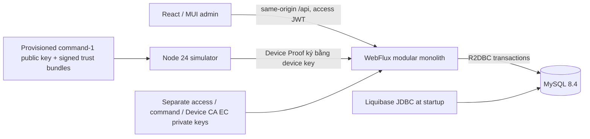
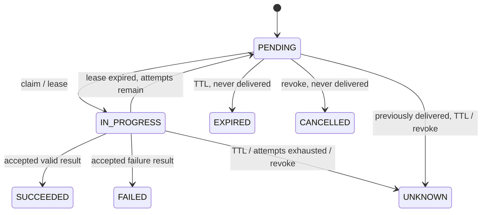

# Kiến trúc và hợp đồng

Một deployable backend tổ chức theo module nghiệp vụ (`identity`, `device`, `policy`, `command`, `audit`, `dashboard`) trong package `src`; trong mỗi module: controller → service interface/impl → repository (Spring Data R2DBC cho CRUD; custom SQL impl cho khóa row, upsert, join và phân trang), entity/DTO map qua ModelMapper (xem [ADR 0004](adr/0004-modular-backend.md), [ADR 0002](adr/0002-hybrid-r2dbc-repositories.md)). Thu hồi thiết bị gọi `DeviceRevocationListener` để module `command` hủy lệnh trong cùng transaction. Rule thuần nằm ở `service.rule`. Transaction dùng `TransactionalOperator`. JDBC chỉ dùng migrations khi khởi động; request dùng R2DBC. BCrypt chạy boundedElastic, demo seed hash chạy startup thread. Timestamp là epoch milliseconds UTC, UUID là chuỗi; không trộn UUID binary và text. Dữ liệu business được ràng buộc cùng tenant bằng FK ghép và SQL scope từ Actor đã xác thực.

## Identity

Một user thuộc một organization. ORG_ADMIN quản lý enrollment/revoke; OPERATOR quản lý policy và command; VIEWER chỉ đọc. Resource chéo tenant trả 404. Backend kiểm tra quyền; route guard chỉ hỗ trợ UX.

Access token ES256 `typ=at+jwt`, issuer `secure-mdm`, audience `secure-mdm-admin`, TTL 10 phút; mỗi request kiểm tra session/user còn hiệu lực trong DB. Opaque refresh token chỉ lưu SHA-256, cookie HttpOnly/Strict, tuyệt đối 7 ngày. Cookie auth endpoints yêu cầu CSRF token lấy qua GET `/auth/csrf`. Refresh khóa session/token, tiêu thụ token cũ và phát hành token mới cùng transaction. Reuse thu hồi session **trước khi** trả 401 để revocation không bị rollback. Logout thu hồi session ngay.

Frontend chỉ giữ access token trong memory; Web Locks serialize cookie operations giữa tab, single-flight trong tab, BroadcastChannel đồng bộ logout/session change. Sau refresh lỗi, marker không chứa secret trong sessionStorage chặn retry tự động cho tới login mới. Browser phải hỗ trợ Web Locks. Frontend dùng axios (một refresh chung khi gặp 401), TanStack Query với query key factory theo feature, Zustand cho state phía client, React Hook Form + Zod cho form, Sonner cho toast ([ADR 0003](adr/0003-frontend-data-stack.md)). Query cache xóa khi identity đổi; chỉ dữ liệu device, command và dashboard poll mỗi 5 giây, và dừng khi tab ẩn.

## Enrollment và device

Token random dùng một lần, 15 phút; SHA-256 trong DB.

Device identity ([ADR 0005](adr/0005-device-identity-x509-proof-of-possession.md)):

- Thiết bị tự sinh khóa EC P-256 và gửi CSR khi enroll. Device CA nội bộ (BouncyCastle, khóa riêng `device-ca.json`) kiểm tra chữ ký CSR, chỉ nhận P-256, tự đặt subject `CN=deviceId,O=organizationId`, serial ngẫu nhiên 128 bit, EKU clientAuth, hiệu lực 30 ngày.
- CSR sai trả 400 trước khi ghi gì, nên token vẫn còn dùng được.
- Khóa enrollment row `FOR UPDATE`; consume + device + certificate + audit nằm trong một transaction.
- Mỗi request agent kèm `Authorization: DeviceProof <jws>`: `kid` = serial, claims `htm`, `htu`, `iat`, `jti`. Server kiểm tra:
  - cert chưa thu hồi, `not_before ≤ now < not_after`, device ACTIVE;
  - chữ ký đúng với public key đã lưu lúc cấp;
  - method và path khớp request;
  - `|now − iat| ≤ 60 s`.
- `jti` được ghi vào `device_proof_replays` (giữ đến `iat + 60 s`) bằng statement riêng, commit trước nghiệp vụ, nên không replay được, kể cả khi nghiệp vụ lỗi.
- Heartbeat mặc định 15 giây; server timestamp quyết định online trong cửa sổ 90 giây. Certificate suy ra cả tenant/device; request body không thay được danh tính.
- Revoke khóa device trước khi thu hồi certificate và cập nhật command.

Simulator sử dụng `proper-lockfile` cho exclusive state directory, temp file mode 0600 + fsync + atomic rename + directory fsync. State gồm private device key (JWK, software-backed), certificate/serial, inventory, messages, policy revision và result ledger; trust store đã làm mới nằm ở `trust.json` cùng thư mục. Tác động mô phỏng và dedup outcome ghi trong cùng snapshot trước result request. Mất response enrollment không tự retry: cấp token mới và identity mới. Dữ liệu state không mã hóa tại rest; quyền filesystem bảo vệ bản demo.

## Command queue

Create khóa user để serialize namespace `(tenant, actor, Idempotency-Key)`, sau đó khóa device. Hash bao gồm device/type/payload. Key giống/nội dung giống trả command cũ; khác nội dung 409. FIFO sử dụng `queue_order` auto-increment để tránh timestamp trùng. Claim khóa device, reconcile các lease, chỉ cấp một lease còn hiệu lực; không transaction nào giữ qua network.

Default: lease 30 giây, max 3 attempts, TTL 10 phút, scheduler 5 giây. Có thể cấu hình `MDM_LEASE_MS`, `MDM_MAX_ATTEMPTS`, `MDM_COMMAND_TTL_MS`, `MDM_SWEEP_MS`; E2E dùng lease ngắn để kiểm tra recovery. Result phải thuộc current attempt và chưa hết lease/TTL. Gửi lại cùng accepted result không tạo tác động/audit mới; stale attempt 409. Không có cam kết exactly-once trên network.

JWS ES256 `typ=mdm-command+jwt` ký tenant, device (audience), jti, type, payload, issuer, iat, exp. Simulator chỉ tin các khóa trong trust store của nó, reject sai algorithm/type/key/issuer/tenant/device/time/id. Không tải key từ header command. Keys access/command/Device CA khác thumbprint. Rotation khóa ký lệnh theo [ADR 0006](adr/0006-command-key-rotation-signed-trust-bundle.md): backend có một bộ command key, ký bằng khóa active, công bố bundle ký bằng từng khóa đang publish qua `GET /device-agent/command-keys`; simulator chỉ nhận bundle ký bởi khóa nó đã tin và từ chối bundle cũ hơn bundle đang giữ. Bốn command có payload/result được validate: REPORT_STATUS, SYNC_DEVICE, SHOW_MESSAGE, LOCK_DEVICE_SIMULATED. SYNC_DEVICE lập tức tải/apply policy và gửi inventory/heartbeat; run cũng đồng bộ policy và heartbeat định kỳ. Không nhận shell/script.

## Policy và audit

Policy metadata + versions bất biến; edit tạo version mới. Một assignment hiện hành/device, revision tăng cả khi bỏ gán; phiên bản mới không tự thay assignment cũ. Report phải đúng revision/version. Server đánh giá screen lock, mã hóa ổ đĩa (`requireDiskEncryption`), minAndroidApiLevel và blockedPackages từ reported inventory; simulator không nâng OS để làm compliance đạt. PENDING khi chờ report đúng revision; UNKNOWN nếu offline/report quá cũ hoặc không có assignment. Simulator data là tự khai báo.

Audit cùng transaction với mutation, actor/tenant/action/resource/time/correlation ID; không lưu token/password/private key. Application không cung cấp update/delete audit. Database administrator vẫn sửa được dữ liệu: không tuyên bố tamper-proof.

## API `/api/v1`

| Nhóm          | Routes                                                                                                                                 |
| ------------- | -------------------------------------------------------------------------------------------------------------------------------------- |
| Auth          | GET `/auth/csrf`, POST `/auth/login`, `/auth/refresh`, `/auth/logout`, GET `/auth/me`                                                  |
| Enrollment    | POST `/enrollment-tokens`, POST `/enrollment-tokens/{id}/revoke`, POST `/device-enrollments`                                           |
| Device        | GET `/devices`, `/devices/{id}`, POST `/devices/{id}/revoke`                                                                           |
| Agent         | POST `/device-agent/heartbeat`, `/device-agent/commands/claim`, `/device-agent/commands/{id}/result`; GET `/device-agent/command-keys` |
| Policy        | GET/POST `/policies`, GET/POST `/policies/{id}/versions`, GET/PUT/DELETE `/devices/{id}/policy-assignment`                             |
| Agent policy  | GET `/device-agent/policy`, POST `/device-agent/policy-report`                                                                         |
| Command/audit | GET/POST `/devices/{id}/commands`, GET `/audit-logs`, GET `/dashboard/overview`                                                        |

List response `{items,total,page,size}`, page 0-based, default size 20, maximum 100. Device `search` tên; audit `action` exact match. Sort cố định và ổn định theo created time/ID; policy history theo version descending. Không nhận SQL sort tùy ý. History của một thiết bị không trả command thuộc device khác. Claim rỗng trả 204. Response lỗi giữ contract `{code,message,status}`, field validation map, hoặc Spring ProblemDetail; security-layer 401/403 cũng JSON. CSRF lỗi 403.

Swagger tại `/swagger-ui.html` (tắt bằng `API_DOCS_ENABLED=false`); health `/actuator/health`. DB migration 001 nền tảng, 002 FIFO/creator FK; không sửa checksum migration đã áp dụng. Demo binds loopback qua Compose; normal profile không seed user.
